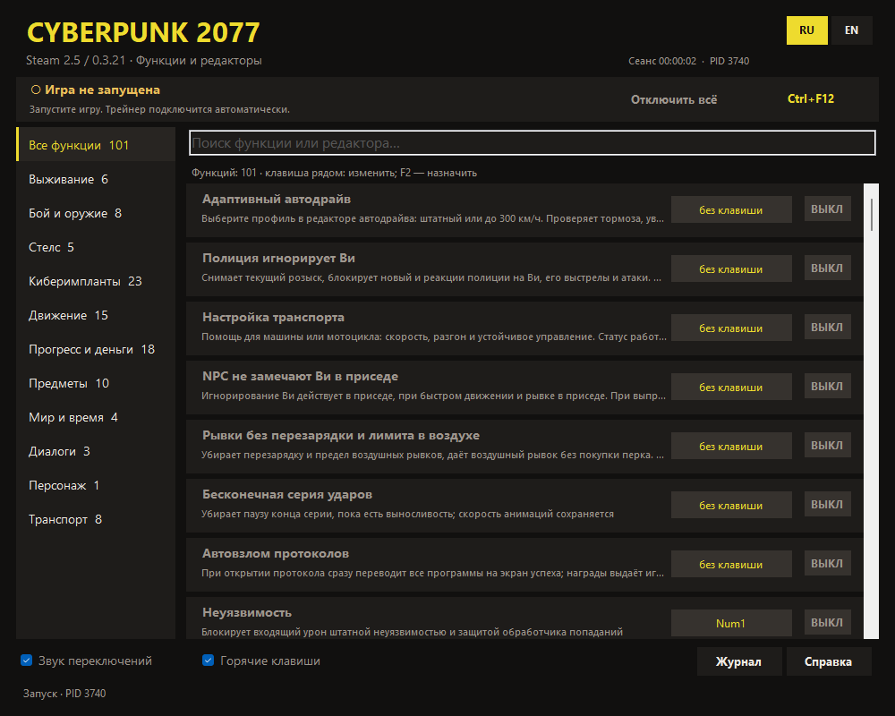
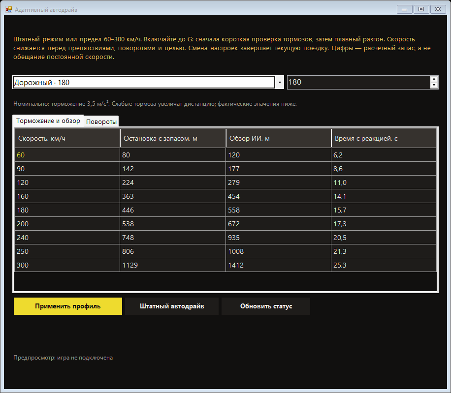
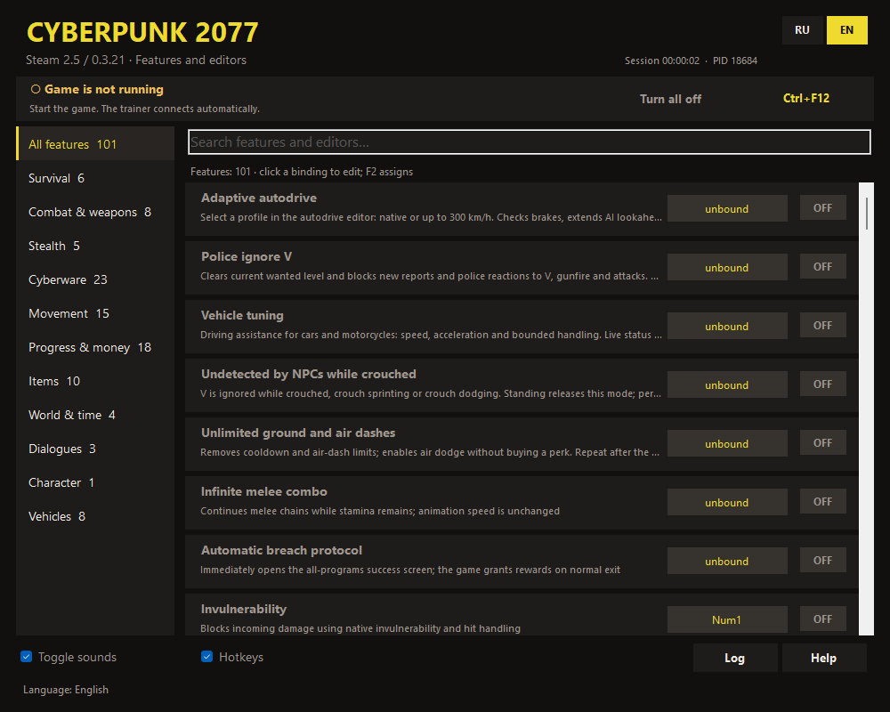
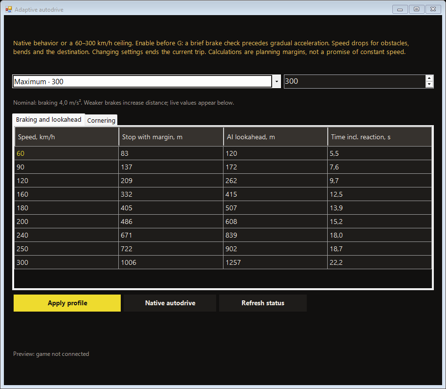

# Cyberpunk 2077 Trainer 0.3.21

**Русский** · [English](#english)

Экспериментальный трейнер CheatKit для одиночной Cyberpunk 2077 на Windows x64. RU/EN, категории, поиск, настраиваемые сочетания клавиш рядом с функциями и сохранение выбранных переключателей. Комплект включает трейнер, мод CheatKit, экспериментальную адаптацию CET, RED4ext и redscript.



## Установка и запуск

1. Скачайте ZIP **FullKit** из [релиза v0.3.21](https://github.com/jestelf/Cyberpunk2077Trainer/releases/tag/v0.3.21), распакуйте в отдельную папку.
2. Закройте игру, лаунчер и трейнер. Запустите `INSTALL.cmd`, выберите корневую папку Cyberpunk 2077, в которой находятся `bin` и `r6`.
3. Запустите игру и загрузите сохранение. При первом запросе CET назначьте клавишу его оверлея. Запустите `Cyberpunk2077Trainer.exe` из распакованного комплекта.
4. Дождитесь подключения, включайте нужные функции. `Ctrl+F12` отключает временные эффекты. Клавиши меняются прямо в строках функций; RU/EN переключаются сверху.

Для удаления закройте игру и трейнер, запустите `UNINSTALL.cmd`, выберите ту же папку. Установщик хранит резервные копии и квитанцию в `%LOCALAPPDATA%\Cyberpunk2077Trainer\installation`. Изменённые после установки файлы не перезаписываются. Если зависимости отличаются от комплектных, установка остановится: не копируйте их поверх вслепую. Предыдущую управляемую установку сначала удалите её установщиком. Сохранения и сторонние моды автоматически не удаляются.

## Совместимость

Только **Steam 2.5, build 26101278, Phantom Liberty**, точный SHA-256 `bin/x64/Cyberpunk2077.exe`:

```text
d36e74c47592e9c656ae250078cb40b2be63c782af5bfbeff2280d43e653fab4
```

Другая сборка отклоняется до изменения памяти. Нужны Windows x64, .NET Framework 4.8 и Microsoft Visual C++ 2015–2022 x64 Redistributable. CET в комплекте основан на 1.37.1 с локальными изменениями ABI/адресов для этой сборки; **это не официальный выпуск CET с поддержкой 2.5**. Совместимость с другими CET-модами не гарантируется. RED4ext 1.30.0 и redscript 1.0.0-preview.22 включены с лицензиями. Озвучки и архивы локализации не входят.

## Функции

| Раздел | Возможности |
|---|---|
| Выживание и бой | Неуязвимость, выносливость, кислород, защита от падения, бесконечные предметы/патроны, без перезарядки, точность/отдача, урон, скорострельность, серия ударов |
| Стелс | Камуфляж, игнорирование NPC постоянно или в приседе, отдельный переключатель игнорирования полицией |
| Нетраннер | RAM без затрат, быстрые скрипты и повторы без очереди, незаметный нетраннер, удержание отключения/дружественности устройств, автовзлом и остановка таймера, мгновенное сканирование |
| Импланты | Ёмкость, подавление Fury, дополнительные слоты, совмещение ОС, выбор активной способности, безлимит реального сандевистана, замедление мира, режим Чёрного заслона |
| Движение | Скорость/прыжок/рывок, воздушные рывки, noclip по взгляду камеры, блинк, телепорт к маркеру/заданию со статусом и отменой |
| Прогресс и предметы | Деньги/уровни/очки, множители опыта, рецепты, бесплатные крафт и улучшения, вес, ItemSpawner с категориями и поиском |
| Диалоги и персонаж | Реплики всех происхождений и без требований навыков, остановка таймера ответа, полный редактор внешности с телом/голосом |
| Транспорт | Защита кузова, скорость/разгон/торможение/поворот/сцепление для машин и мотоциклов, устойчивый пресет, поставить на колёса |

Noclip: WASD по направлению камеры, Space/Ctrl вверх/вниз, Shift быстрее. Чёрный заслон: средняя кнопка мыши включает режим пустых рук, ЛКМ атакует. Сандевистан требует установленного импланта. Прочие сочетания и ограничения видны в интерфейсе и справке.

**Адаптивный автодрайв:** Транспорт → Профили и расчёты автодрайва → Штатный / Спокойный 120 / Дорожный 180 / Быстрый 240 / Максимальный 300. Усиленные профили допускают настройку до 300 км/ч. Примените профиль перед G: проверка тормозов, плавный рост скорости, расширенный обзор штатного ИИ, снижение скорости перед препятствием, поворотом и целью. Фактический потолок зависит от замедления и доступной опоры. «Штатный» сохраняет параметры игры. Смена настроек/отключение завершает поездку, G запускает новую. [Параметры, формулы и ограничения](docs/autodrive.md).



Телепорт использует маркер текущей цели задания, а при нескольких резервных координатах выбирает ближайшую. Личный маркер ищется в радиусе 8 м, задание — предпочтительно за 20 м, максимум 24 м; другой этаж с разницей высоты от 8 м не считается прибытием. Положение движущегося маркера обновляется. Убрано завершение на площадках за 60–90 м.

ItemSpawner получает каталог из вашей игры при первом открытии после загрузки сохранения; «Обновить список» повторяет чтение. Названия берутся на языке игры, при недоступной локализации используется ID. Каталог сохраняется локально, переключение RU/EN не переводит названия предметов. Публичный пакет использует значки категорий; игровые картинки и выгрузки не распространяются. Можно использовать свой локальный `catalog/catalog.tsv` и иконки в `%LOCALAPPDATA%\Cyberpunk2077Trainer`.

## Что проверено и ограничения

Владелец подтвердил работоспособность основных существующих функций и попросил убрать устаревшие пометки «не проверено»; вместо них в интерфейсе стоят описания действий. Последний конкретный отчёт: телепорт оставлял далеко от цели, а штатный автодрайв ехал медленно. Телепорт уточнён в 0.3.20; в 0.3.21 автодрайв переработан с учётом торможения и прогноза дороги. Новое ограничение расстояния, ультра автодрайв и чтение каталога из игры проверены локально; результат именно этих новых изменений в игре ещё ожидается. Подробнее: [VERIFY.md](VERIFY.md).

Локально проверены компиляция C#/C++, 16 REDscript без ошибок/предупреждений, 309 проверок диспетчера, 28 контроллера перемещения, 142 проверки модели, 21 нативного диспетчера и 19 настройки профилей автодрайва; сценарии адаптивного контроллера, чтение каталога, установщик и RU/EN. API/физика/стриминг в фикстурах имитируются. Релиз помечен предварительным из-за новых изменений и экспериментальной адаптации CET.

Сделайте отдельное сохранение перед использованием. Деньги, предметы, рецепты, навыки, улучшения и внешность могут сохраниться: отключение их не отменяет. Тело/голос влияют на сюжетные и романтические проверки. Телепорт требует доступной поверхности: перемещается по поддерживаемым участкам, может остановиться на последней безопасной точке; закрытые интерьеры и неподгруженные маршруты не гарантируются. Завершите или отмените перенос до сохранения. Старый розыск после выключения игнорирования полиции не возвращается. Одновременное оружие рук не поддерживается. Защита/таймеры/скриптовые сцены имеют ограничения, описанные в интерфейсе.

## Антивирусы

Неподписанные трейнер и нативный мод работают с процессом игры, поэтому возможны срабатывания. Сверьте SHA-256 из релиза и изучите исходники. Автоматически отключать защиту не требуется. Исходники не содержат файлов игры, сохранений, профилей, журналов и личных путей сборки.

## Сборка

Нужны Git, MSVC x64 с Windows SDK, .NET Framework C# compiler и PowerShell. Из корня репозитория:

```powershell
powershell -ExecutionPolicy Bypass -File ports/Get-BridgeSdk.ps1
powershell -ExecutionPolicy Bypass -File build.ps1 -Sdk .\deps\bridge-sdk\include -RuntimeTools X:\FullKit\dependencies
```

`X:\FullKit` — распакованный релиз с комплектными зависимостями. При другом расположении MSVC укажите `-VcVars`; результат — `dist`. Выходная папка должна быть пустой. Исходники и инструкции CET: [ports/cet25](ports/cet25/README.md). Сборка не требует файлов установленной игры и не запускает игру.

## Лицензия

Код CheatKit — [MIT](LICENSE), Copyright (c) 2026 jestelf. Зависимости имеют собственные лицензии: [licenses](licenses/README.md). Cyberpunk 2077 принадлежит CD PROJEKT RED; проект с ними не связан.

## English

Experimental CheatKit trainer for single-player Cyberpunk 2077 on Windows x64. RU/EN UI, categories, search, inline configurable hotkeys and saved toggle selections. The FullKit contains the trainer, CheatKit mod, experimental CET adaptation, RED4ext and redscript.



### Install and run

1. Download the **FullKit ZIP** from [v0.3.21](https://github.com/jestelf/Cyberpunk2077Trainer/releases/tag/v0.3.21) and extract it to a separate folder.
2. Close the game, launcher and trainer. Run `INSTALL.cmd` and choose the game root containing `bin` and `r6`.
3. Start the game, load a save, assign a CET overlay key if prompted, then open `Cyberpunk2077Trainer.exe` from the extracted kit.
4. Wait for connection. Change bindings beside each feature; select RU/EN at the top. `Ctrl+F12` resets temporary effects.

To remove, close the game/trainer, run `UNINSTALL.cmd` and select the same folder. Backups and receipts live in `%LOCALAPPDATA%\Cyberpunk2077Trainer\installation`. Modified files and conflicting dependencies are preserved; installation stops instead of overwriting them. Uninstall an earlier managed installation with its original installer first. Saves and unrelated mods are not automatically removed.

### Compatibility

Only **Steam 2.5 build 26101278 with Phantom Liberty**, matching the EXE SHA-256 printed above. Unknown builds are rejected before memory changes. Requires Windows x64, .NET Framework 4.8 and Microsoft Visual C++ 2015–2022 x64 Redistributable. Included CET is based on 1.37.1 with local ABI/address changes: **not an official CET release claiming 2.5 support**. Other CET mods may be incompatible. Includes RED4ext 1.30.0 and redscript 1.0.0-preview.22 with notices; no dubbing/localization archives.

### Features and controls

Survival, stamina/oxygen/fall protection; ammo/items, reload/recoil/accuracy/damage/fire rate; camouflage and permanent/crouched undetection; police ignore; unlimited RAM, instant repeatable quickhacks, quiet netrunning, device control, breach completion/timer and instant scanning; cyberware capacity/slots/combined OS, implant-based unlimited Sandevistan and Blackwall; movement/jump/dash/noclip/blink and waypoint/objective travel; money/levels/points, crafting/upgrades/recipes and categorized ItemSpawner; dialogue checks/timers, full appearance editor including body/voice; car/motorcycle speed, acceleration, braking and handling, damage protection and upright recovery.

Noclip: camera-relative WASD, Space/Ctrl up/down, Shift faster. Blackwall: middle mouse toggles empty-hand mode, left mouse attacks. Sandevistan needs an installed implant. Other bindings and feature-specific limits appear in the UI/help.

ItemSpawner reads records from your running game on first opening after loading a save; Reload list refreshes them. Names use the game's language, falling back to IDs. The cached catalog does not translate item names when switching UI language. The public build uses category symbols and distributes no game artwork/catalog dumps. A personal `catalog/catalog.tsv` and icons may be placed under `%LOCALAPPDATA%\Cyberpunk2077Trainer`.

### Verification and limits

The owner confirmed that the main existing features work and requested replacing obsolete untested labels with useful descriptions. Their latest specific reports concerned distant teleport landings and slow native autodrive, addressed by travel fixes in0.3.20 and braking-aware adaptive driving in0.3.21. New travel bounds, Ultra autodrive and live catalog reading are locally tested; gameplay results for those new changes are pending. Checks cover C#/C++, 16 REDscript files with no errors/warnings, 309 dispatcher checks, 28 travel-controller and 142 model, 21 native-adapter and19 profile-configuration checks, plus adaptive-controller scenarios, catalog/installer tests and RU/EN. Native APIs, physics and streaming are mocked. See [VERIFY.md](VERIFY.md). This is a prerelease for the new changes and experimental CET adaptation.

**Adaptive autodrive:** Vehicles → Autodrive profiles and calculations → Native / Relaxed120 / Road180 / Fast240 / Maximum300. Enhanced profiles allow ceilings up to300km/h. Apply before G: brake check, gradual acceleration, extended native AI vision, speed reduction for obstacles, bends and destination. Actual ceilings depend on braking and available ground. Native preserves game settings. Changing settings/disabling ends the trip; G starts another. [Parameters, formulas and limits](docs/autodrive.md).



Travel now resolves the tracked objective marker, choosing the nearest fallback coordinate when necessary. Personal waypoints search within 8 m; objectives prefer 20 m and at most 24 m, rejecting floor differences of 8 m or more. Moving markers are refreshed. Landings 60–90 m away are no longer reported as completion.

Use a separate save. Money, items, recipes, progression, upgrades and appearance can persist; disabling does not undo them. Body/voice can affect story/romance checks. Travel follows supported surfaces and may stop at the last safe landing; closed interiors and unloaded routes are not guaranteed. Finish/cancel travel before saving. Disabling police ignore does not restore previous wanted stars. Simultaneous arm weapons are unsupported. Scripted scenes and timers have additional UI-documented limits.

### Antivirus, building and license

Unsigned trainer/native mod interaction with the game may trigger detections. Check release SHA-256 and inspect the source; disabling protection is not required. No game files, saves, profiles, logs or personal build paths are distributed.

Build with Git, MSVC x64/Windows SDK, .NET Framework C# compiler and PowerShell using the commands above. Replace `X:\FullKit` with the extracted release; pass `-VcVars` if necessary. Output is `dist` and must be empty before building. [CET source instructions](ports/cet25/README.md). No installed game files are needed and building does not launch the game.

CheatKit is [MIT](LICENSE), Copyright (c) 2026 jestelf. [Third-party licenses](licenses/README.md) apply separately. Cyberpunk 2077 belongs to CD PROJEKT RED; this project is unaffiliated.
